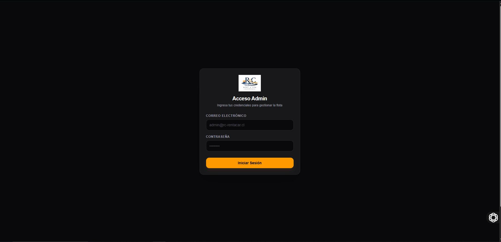
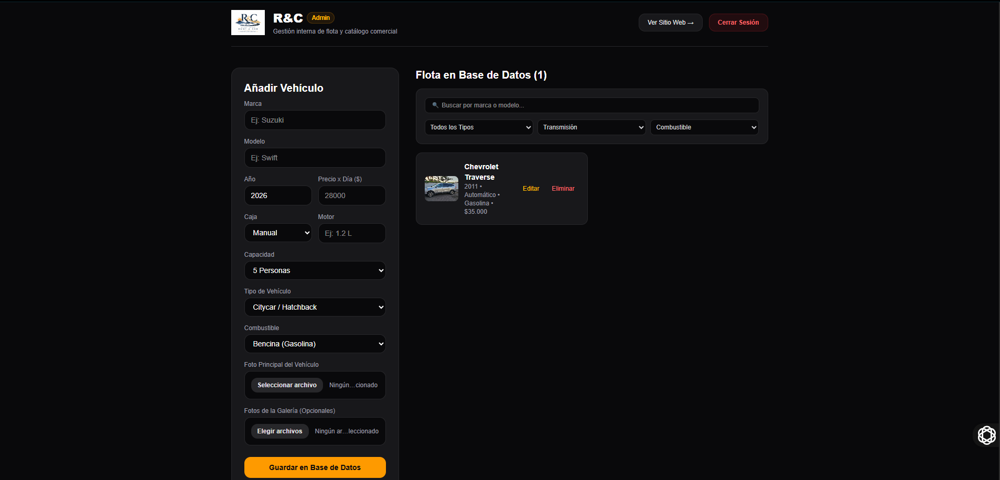
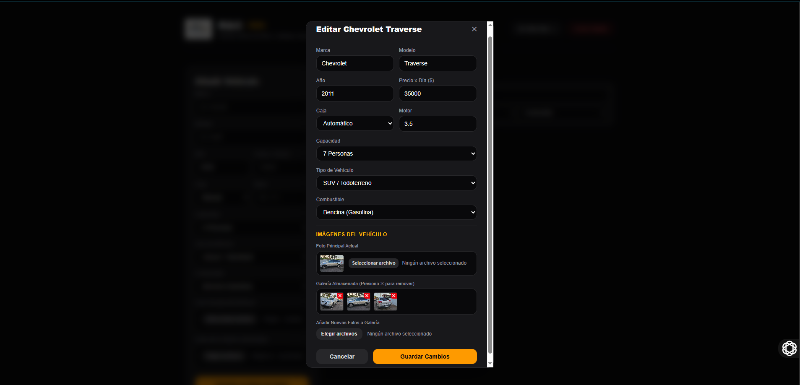
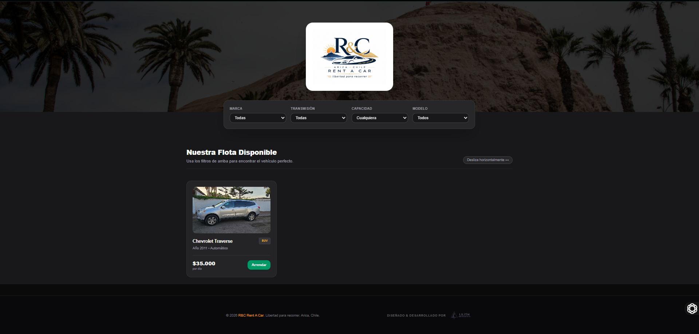
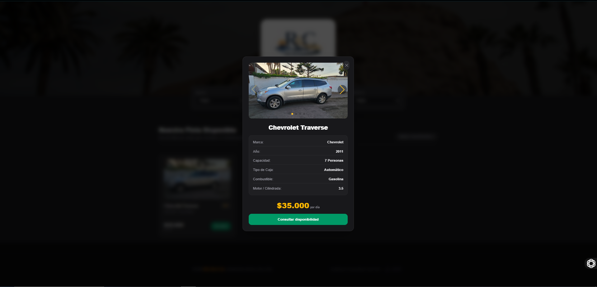

# R&C Rent a Car 🚗

**Plataforma web de catálogo y gestión de flota de vehículos**, desarrollada con **Next.js, React, TypeScript, Tailwind CSS y Supabase**. Reúne una interfaz pública para explorar automóviles y un panel administrativo para registrar y mantener la información de la flota.

> **Proyecto de desarrollo web para portafolio.** La versión documentada permite consultar vehículos y contactar por WhatsApp. **No incluye reservas confirmadas, pasarela de pago ni pagos en línea.**

## Características principales

### Catálogo público

- Visualización de vehículos con fotografía, marca, modelo, año y precio diario.
- Filtros por **marca, transmisión, capacidad y modelo**.
- Ficha individual con datos técnicos y **galería fotográfica**.
- Botón para consultar disponibilidad mediante contacto externo por **WhatsApp**.
- Interfaz adaptable a distintos tamaños de pantalla.

### Panel administrativo

- Inicio de sesión con **Supabase Authentication**.
- Visualización de los registros de la flota obtenidos desde **Supabase / PostgreSQL**.
- **Operaciones CRUD** sobre vehículos: registrar, consultar, editar y eliminar.
- Búsqueda y filtros de vehículos en el panel.
- Formulario para indicar marca, modelo, año, precio por día, transmisión, combustible, capacidad, motor y tipo de vehículo.
- Carga de una **fotografía principal** y varias imágenes de galería mediante **Supabase Storage**.
- Edición de datos, sustitución de la imagen principal y gestión de fotografías existentes.

## Evidencia visual

Las siguientes imágenes corresponden a **capturas reales de la aplicación** durante su ejecución, tanto en el área administrativa como en el catálogo público.

### 1. Acceso administrativo

Formulario de inicio de sesión por correo y contraseña para ingresar al panel de gestión de flota.



### 2. Panel de gestión de flota

Vista administrativa con formulario de creación, listado de vehículos, buscador, filtros y opciones de edición o eliminación.



### 3. Edición de vehículos

Formulario de edición con actualización de especificaciones técnicas, precio por día, imagen principal y galería de fotografías.



### 4. Catálogo público

Interfaz principal con filtros y tarjetas de vehículos, incluyendo fotografía, modelo y precio diario.



### 5. Detalle del vehículo

Ventana con fotografías, características técnicas, capacidad, precio de arriendo diario y opción para consultar disponibilidad.



## Tecnologías utilizadas

| Tecnología | Aplicación |
| --- | --- |
| **Next.js 16** (App Router) | Rutas y estructura del sitio |
| **React 19** | Componentes de la interfaz |
| **TypeScript** | Tipado de datos y componentes |
| **Tailwind CSS 4** | Estilos y diseño adaptable |
| **Supabase / PostgreSQL** | Persistencia y consulta de vehículos |
| **Supabase Authentication** | Autenticación del panel administrativo |
| **Supabase Storage** | Almacenamiento de imágenes de vehículos |
| **Swiper** | Navegación de galerías de imágenes |

*Las versiones principales se basan en el archivo `package.json` del proyecto compartido.*

## Estructura del proyecto

```text
app/
├── admin/
│   └── page.tsx          # Panel de administración de flota
├── components/
│   ├── CarCard.tsx       # Tarjeta del catálogo
│   ├── CarModal.tsx      # Detalle y galería del vehículo
│   └── footer.tsx       # Pie de página
├── data/
│   └── cars.json         # Datos de ejemplo
├── lib/
│   └── supabase.ts       # Configuración del cliente Supabase
├── login/
│   └── page.tsx          # Inicio de sesión
├── types/
│   └── car.ts            # Tipo de dato para vehículos
├── globals.css
└── page.tsx              # Catálogo público
public/                   # Logos y recursos estáticos
docs/
└── imagenes/             # Capturas utilizadas en el README
```

La aplicación consulta los vehículos de la tabla **`cars`** en Supabase; `app/data/cars.json` contiene datos de ejemplo y no sustituye la conexión con la base de datos.

## Instalación y ejecución local

**Requisitos:** Node.js compatible con Next.js 16, npm y un proyecto de Supabase configurado.

1. Clona tu repositorio y entra en la carpeta del proyecto:

   ```bash
   git clone <URL-DE-TU-REPOSITORIO>
   cd <NOMBRE-DEL-REPOSITORIO>
   ```

2. Instala las dependencias:

   ```bash
   npm ci
   ```

3. Crea el archivo **`.env.local`** en la raíz con las credenciales *públicas* de tu proyecto Supabase:

   ```dotenv
   NEXT_PUBLIC_SUPABASE_URL=https://TU-PROYECTO.supabase.co
   NEXT_PUBLIC_SUPABASE_ANON_KEY=TU_CLAVE_PUBLICA_ANON_O_PUBLISHABLE
   ```

4. Ejecuta el servidor de desarrollo:

   ```bash
   npm run dev
   ```

5. Abre [http://localhost:3000](http://localhost:3000) para el catálogo o [http://localhost:3000/login](http://localhost:3000/login) para iniciar sesión.

> **Importante:** no subas a GitHub contraseñas, archivos `.env.local`, tokens secretos ni la clave `service_role` de Supabase. Las variables que comienzan con `NEXT_PUBLIC_` son accesibles desde el navegador; solo deben contener credenciales de cliente autorizadas para ser públicas.

### Datos y almacenamiento

El código utiliza una tabla **`cars`** con propiedades como `id`, `brand`, `model`, `year`, `transmission`, `fuel`, `capacity`, `motor`, `price`, `image`, `type` y `gallery`. Las fotografías se gestionan mediante el bucket **`car-images`** de Supabase Storage.

Las políticas de acceso y la estructura de base de datos deben configurarse en el proyecto Supabase correspondiente. **No se adjuntan migraciones SQL completas** en el código fuente compartido.

## Estado actual y consideraciones técnicas

- En las capturas se observa la aplicación funcionando con el **catálogo, la ficha de vehículo y el panel administrativo** después de reactivar Supabase.
- La fotografía principal del Chevrolet Traverse se recuperó tras **volver a cargar la imagen**; si una imagen falla, se deben revisar la ruta del archivo y los permisos de Storage.
- La aplicación depende de la disponibilidad del proyecto Supabase y de sus recursos de autenticación, datos y almacenamiento.
- El inicio de sesión utiliza un mensaje genérico para diferentes errores; conviene diferenciar **credenciales incorrectas** de problemas de conexión.
- La interfaz comprueba la sesión, pero el control real de acceso a la información debe asegurarse mediante **políticas RLS y políticas de Storage**. No debe considerarse seguro únicamente por ocultar el panel de administración.
- Antes de usarlo públicamente, conviene **unificar y verificar los enlaces de contacto de WhatsApp** definidos en los componentes.
- Las imágenes de vehículos destinadas a publicación deben revisarse para evitar exponer patentes u otros datos que no se desee mostrar.

## Mejoras futuras

- Reforzar la autorización administrativa y las políticas de seguridad de Supabase.
- Mejorar los mensajes de error y los estados de carga.
- Centralizar la configuración de contactos y recursos externos.
- Agregar pruebas funcionales y automatizadas para filtros, autenticación y CRUD.
- Mejorar la gestión y validación de imágenes.
- Evaluar un flujo de reservas en línea como ampliación futura, sin presentarlo como una función ya implementada.

## Autora

**Annais Poulet Romero Díaz**  
Ingeniera en Informática  
GitHub: [Annais-Romero](https://github.com/Annais-Romero)

*Proyecto de desarrollo web presentado como evidencia de conocimientos en frontend, TypeScript, bases de datos, servicios cloud y gestión de información.*
